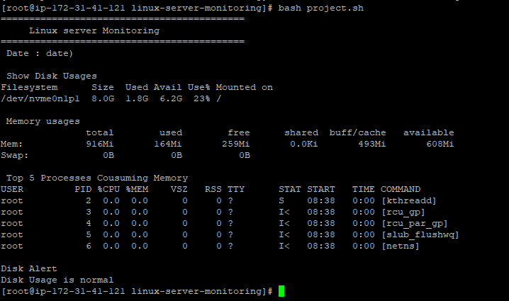
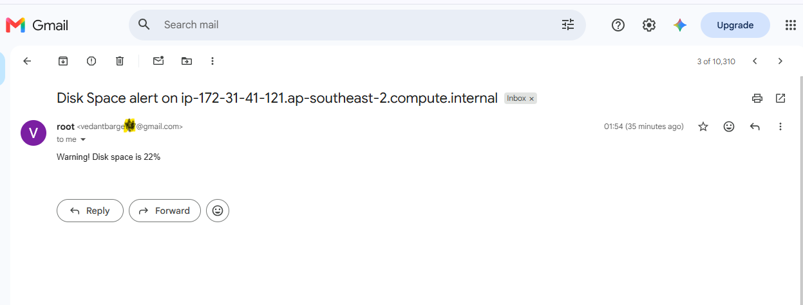

# Linux Server Monitoring and Email Alert System

## About the Project

I built this project to improve my practical Linux and shell scripting skills.

The main idea was to create a simple monitoring script that checks important server resources and sends an email alert when disk usage becomes too high.

I worked on this project using an AWS EC2 Linux instance and learned how basic Linux administration tasks can be automated.

## What This Project Does

- Checks server disk usage.
- Displays RAM and memory usage.
- Shows the top 5 processes consuming memory.
- Sends an email alert if disk usage reaches 80% or above.
- Saves monitoring output in a log file.
- Uses Cron to run the script automatically every day.

## Tools and Technologies

- Linux (Amazon Linux)
- Bash Shell Scripting
- AWS EC2
- Git and GitHub
- Postfix and Gmail SMTP
- Cron

## Project Files

```text
linux-server-monitoring/
│
├── project.sh
└── .gitignore
```

## How to Run the Project

First, clone this repository:

```bash
git clone https://github.com/vedantbarge/linux-server-monitoring.git
```

Move into the project directory:

```bash
cd linux-server-monitoring
```

Give execute permission:

```bash
chmod +x project.sh
```

Run the script:

```bash
./project.sh
```

## Email Alert Setup

I configured Postfix on my EC2 instance and connected it to Gmail SMTP using an App Password.

When disk usage reaches 80% or above, the script sends an email notification.

**Note:** Email alerts require Postfix and SMTP configuration before running the project.

## Automatic Execution Using Cron

I configured a Cron job to execute the monitoring script every day at midnight.

Example:

```bash
0 0 * * * /bin/bash /root/linux-server-monitoring/project.sh >> /root/linux-server-monitoring/monitoring.log 2>&1
```

## What I Learned

While building this project, I got practical experience with:

- Writing and executing Bash scripts.
- Using Linux commands to monitor disk and memory.
- Working with `df`, `free`, and `ps`.
- Using if-else conditions in shell scripting.
- Configuring email alerts with Postfix.
- Scheduling tasks using Cron.
- Managing project files with Git and GitHub.

## Future Improvements

- Add CPU usage monitoring.
- Add memory usage alerts.
- Improve email alert reports.
- Add more server health checks.

## Author

**Vedant Barge**

GitHub: https://github.com/vedantbarge


## Project Screenshots

### 1. Server Monitoring Output


### 2. Cron Job Automation


### 3. Email Alert



